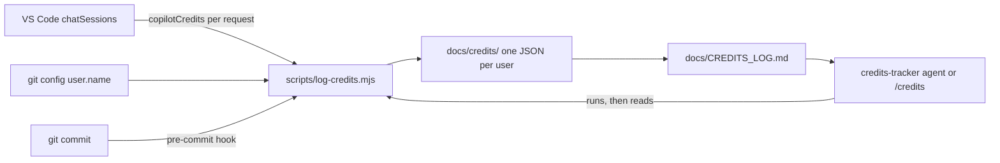

# Credits Tracker

Reports and documents Copilot credit consumption of the project, per user, day, and session. Logging is automatic: nobody has to type a value.

- Agent: `.github/agents/consultants/credits-tracker.agent.md`
- Prompt: `.github/prompts/credits.prompt.md` (`/credits`)
- Script: `scripts/log-credits.mjs`
- Output: `docs/CREDITS_LOG.md` (history) and `docs/credits/` (data)
- Hook: `.githooks/pre-commit`

---

## How It Works



1. VS Code Copilot Chat stores each session locally as an event log (`chatSessions/<sessionId>.jsonl`). For every request it records `copilotCredits`, `promptTokens`, `completionTokens`, and a timestamp.
2. The script rebuilds each session from that log, sums the credits of its requests, and groups them by day.
3. The result is saved per user and the changelog-style log is regenerated from all user files.
4. The log is refreshed in two ways: on every commit (hook), or whenever the agent is invoked.

The session total matches the "Session Cost" shown in the VS Code context panel, which is the sum of the credits of its requests.

---

## The Agent

`credits-tracker` is a consultant agent (group `.github/agents/consultants/`). It has read, search, and execute tools, and can run only `node scripts/log-credits.mjs`.

### What it does

- Refreshes the log before answering.
- Answers questions about the project total, consumption per user, per day, per session, and the heaviest tasks.
- Compares periods and flags unusual spikes.
- States the limits of the data when they affect an answer.

### What it does not do

- Does not estimate or invent figures; it reports what the log shows.
- Does not edit `docs/CREDITS_LOG.md` or `docs/credits/` by hand.
- Does not read billing data from GitHub; figures can differ from the organization's billing report.

### How to invoke it

- Prompt: `/credits`, optionally followed by a focus ("only yesterday", "by user", "session fce7c1ad").
- Chat: select the `credits-tracker` agent, or ask about credit consumption and the orchestrator routes the request (see `.github/copilot-instructions.md`).

### Response format

```md
## Credits Summary

- Period: [dates covered]
- Project total: [credits]
- By user: [user: credits]
- Heaviest sessions: [id, title, credits]

### Notes

- [Limits that affect these figures]
```

---

## The Script

```txt
node scripts/log-credits.mjs [--quiet] [--install-hook]
```

| Option | Effect |
|---|---|
| (none) | Reads this workspace's sessions, updates the data and the log, prints a one-line summary. |
| `--quiet` | Same, without output. Used by the hook. |
| `--install-hook` | Sets `core.hooksPath` to `.githooks` so the log is updated on every commit. Run once per clone. |

| Environment variable | Effect |
|---|---|
| `CREDITS_STORAGE_DIR` | Overrides the VS Code `workspaceStorage` folder to scan. |

### Where it looks for sessions

Under `workspaceStorage` of VS Code and VS Code Insiders:

| OS | Base folder |
|---|---|
| Windows | `%APPDATA%/Code/User/workspaceStorage` |
| macOS | `~/Library/Application Support/Code/User/workspaceStorage` |
| Linux | `$XDG_CONFIG_HOME` or `~/.config/Code/User/workspaceStorage` |

Each subfolder has a `workspace.json` with the opened folder; the script uses only the ones that match this repository.

### Rules it follows

- **Identity:** the user is `git config user.name` (falls back to the OS user). All sessions found on a machine belong to that user.
- **Idempotent:** a session is identified by its id. Running the script again updates it instead of duplicating it.
- **Never lowers a value:** if a stored session has more credits than the one just read (for example the local file was compacted), the stored one is kept.
- **Per-day attribution:** a session that spans several days contributes to each day by the date of each request.
- **No data:** if no session data is found for the workspace, the log is left unchanged.
- **Tolerant parsing:** unreadable lines or sessions are skipped, never fatal.

---

## Output Files

### `docs/credits/<user>.json`

One file per contributor, so concurrent commits do not conflict on the same file.

```json
{
  "user": "arielpossumus",
  "sessions": {
    "<sessionId>": {
      "sessionId": "...",
      "title": "Session title",
      "user": "arielpossumus",
      "credits": 76.05,
      "requests": 11,
      "completionTokens": 0,
      "peakPromptTokens": 0,
      "firstAt": "2026-11-06T00:00:00.000Z",
      "lastAt": "2026-11-06T00:00:00.000Z",
      "days": { "2026-11-06": { "credits": 76.05, "requests": 11 } }
    }
  }
}
```

### `docs/CREDITS_LOG.md`

Generated, changelog-style, newest day first: project total, total per user, then one section per day with one block per user and one line per session.

```md
## [2026-11-06] - 76.05 credits

### arielpossumus - 76.05 credits

- `fce7c1ad` Session title: 76.05 credits, 11 request(s), peak context 126.1K tokens
```

---

## Automatic Logging

Run once per clone:

```txt
node scripts/log-credits.mjs --install-hook
```

From then on, `.githooks/pre-commit` runs the script on every commit and stages `docs/CREDITS_LOG.md` and `docs/credits/`. The hook never blocks a commit, even if the script fails.

Without the hook, the log is still refreshed whenever the agent or `/credits` is used.

---

## Limits

- **Session in progress:** VS Code writes the latest requests to disk with a delay, so the last requests of the current session may be missing until the next refresh.
- **Per machine:** each contributor's sessions exist only on their machine. A user who has not run the script or committed with the hook is missing from the log.
- **Internal format:** the session files are an internal VS Code format (schema version 3, Copilot Chat 0.72.0 when this was written). If a VS Code update changes it, the script skips what it cannot read; report discrepancies instead of correcting figures by hand.
- **Not billing:** the figures come from per-request values recorded by Copilot Chat, not from the GitHub billing report.
- **Merge conflicts:** `docs/CREDITS_LOG.md` is generated; if it conflicts, resolve by running the script again.

---

## Framework Integration

- Registered in `.vscode/settings.json` (`chat.agentFilesLocations`), the Framework Paths table of `.github/copilot-instructions.md`, and the naming rules of `scripts/validate-framework.mjs`.
- Introduced in framework version 3.1.0 (`docs/FRAMEWORK_CHANGELOG.md`).
